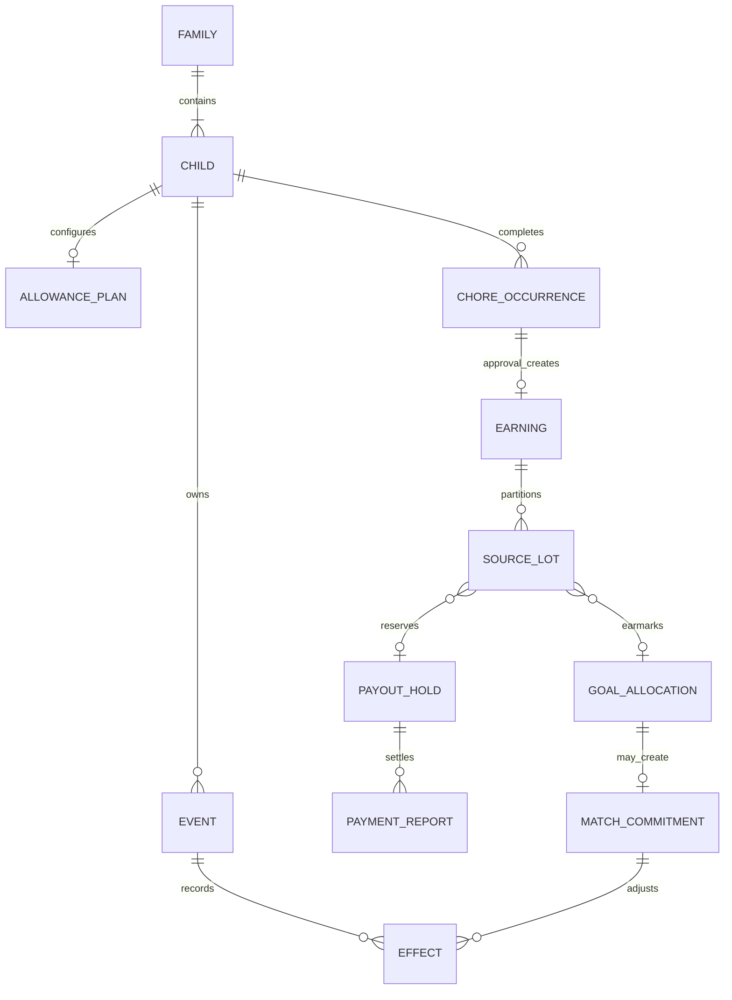
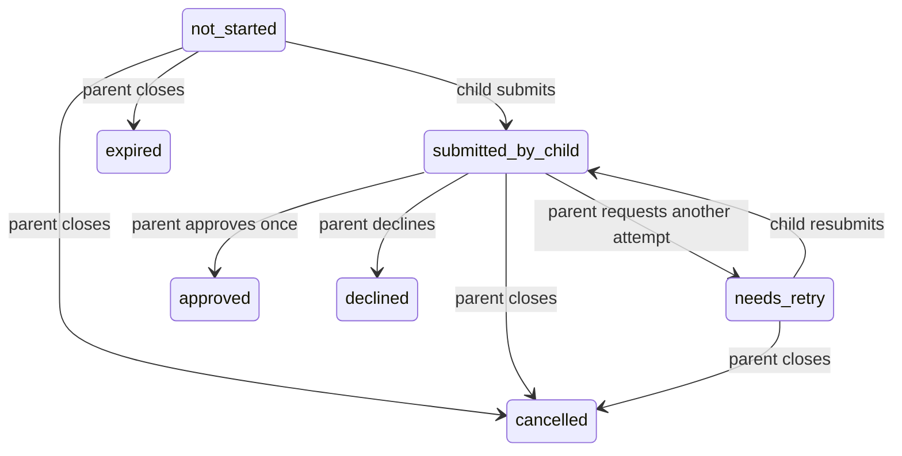

# Allowance ledger implementation

Implementation: `apps/mobile/src/finance/`. This is a fictional, in-memory prototype. It neither holds money nor verifies a provider payment. Reloading the application clears financial changes. The role selector is a demonstration control, not authentication.

## Contract and event model

`createFinanceState(timezone, children)` creates one family ledger. `seedFinanceState(at?)` creates Sam's $30 weekly example, three unapproved chores and three empty goals; matching is off. `applyFinanceCommand(state, actor, command)` returns a new frozen ledger or throws a readable validation error. Commands carry an operation ID, UTC timestamp and child ID. `financeView(state, actor, childId, at?)` returns a role-specific projection, never the raw event ledger.

The event log is authoritative. Projections replay commands in acceptance order. Each event includes its actor and computed effects, including automatic allocations, match commitments, match reversals and reconciliation obligations. Corrections append new events; original submissions, approvals and payment reports remain in history. No event is deleted or silently rewritten. Role-filtered activity exposes the actor, reference, applicable monetary amount and optional note; child activity never exposes hidden matching effects.

Reusing an operation ID with the same actor and payload is a no-op; reusing it for a different action fails. Duplicate reviews with different IDs also fail because the occurrence has already left its submitted state. The application must apply each command against the latest state atomically. This in-process protection does not replace a production database transaction, authenticated actor or unique server constraint.

## Money and calendar rules

- USD values are non-negative safe integer cents. Money fields reject decimals, negatives, NaN, infinity and unsafe integers. Dollar entry accepts at most two decimal places; percentages use integer multiplication with BigInt intermediates and round down to cents. Currency formatting uses an integer dollar quotient and cent remainder, preserving the exact last cent even at the accepted upper bound. No fractional cent is credited.
- All timestamps are valid UTC calendar instants; impossible dates and 24:00 are rejected. Event acceptance is chronological. A separately recorded `paidAt` may be earlier than the reporting event, never in its future.
- The family IANA zone is fixed when its ledger is created. Weekly and biweekly periods count calendar days from a configured local anchor; monthly periods use local calendar months. DST does not divide milliseconds into assumed 24-hour local days.
- Potential task rewards are reserved against their due-date allowance period. Every independent recurrence occurrence counts. Assignments and future edits that oversubscribe any configured period fail atomically; the parent can explicitly increase the budget first.

## Chores and earnings

Only approval creates an earning, using the occurrence's frozen reward. Child submission never credits funds. Review records a note and timestamp through its event. An optional evidence requirement means a short completion note; there is no photo capture or upload. Future edits affect only unstarted occurrences dated today or later. Submitted, approved and past occurrences retain their original terms.

`recurrenceDates` expands one-time, daily or selected-weekday weekly definitions into distinct dates over an explicit window of up to 366 days. Each occurrence ID combines definition ID and date. The prototype prepares the selected window in memory; it does not claim a persistent background scheduler.

An earning is partitioned into source lots. Free, goal-earmarked, payout-held and parent-reported-paid portions cannot claim the same cents. Reversing an earning removes its unpaid portions and compensates related matching. Already reported-paid portions retain their reports and create a reconciliation obligation. Correcting the associated payment report then clears that obligation without resurrecting invalid earnings.

## Payout cadence and manual execution

Allowance budgeting and payout cadence are independent. Per-task payouts are immediately eligible; daily, weekly, biweekly and monthly reminders select unpaid free lots from completed family-local cadence periods. An unspecified `prepare_payout` amount batches only these due lots. A parent may explicitly prepare a manual amount from available earnings sooner. Minimum payout applies to requests and preparations.

Creating a child request or parent preparation reserves source lots immediately. Goal allocations and other payout requests cannot spend held cents. A parent can report part of a payout using cash, manual, Cash App or Venmo, with a date and note. Remaining cents stay held until paid or explicitly cancelled. Cancelling returns only the unpaid remainder. A child can acknowledge receipt; this is family acknowledgment, not provider confirmation.

Statuses distinguish requested, prepared, partially paid, parent-reported paid, cancelled and corrected. No provider-confirmed state exists. Reversing a report retains the original report marked reversed, returning valid unpaid money to its hold or available balance as appropriate. Previously paid cents never become newly match-eligible after a reversal.

## Read boundaries and checks

Child commands require the matching child ID. Assignment, budgets, review, held-fund declarations, payout execution and parent matching controls require a parent actor in the domain, in addition to UI guards. Child goal selection, completion and acknowledgment remain child actions. Child projections exclude matching configuration, hidden commitments, parent-only corrections and matching activity. The global process still contains both fictional roles; this is not shared-device production security.

Domain regression tests are in `apps/mobile/tests/finance.test.ts`. They cover exact cents, leap/DST/year boundaries, recurring occurrences, budget protection, idempotency, role and sibling isolation, payout holds, partial payment/acknowledgment/reversal, matching caps and equivalent child projections. Run `npm test` from `apps/mobile`. Native interaction and accessibility results belong in the mission QA report, not this domain specification.
